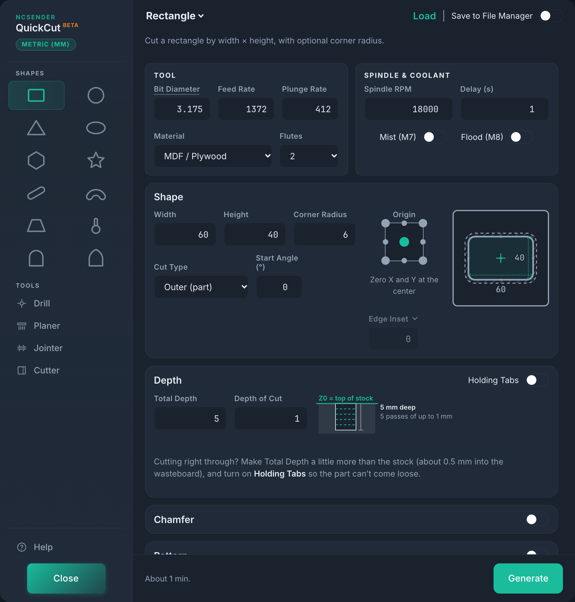
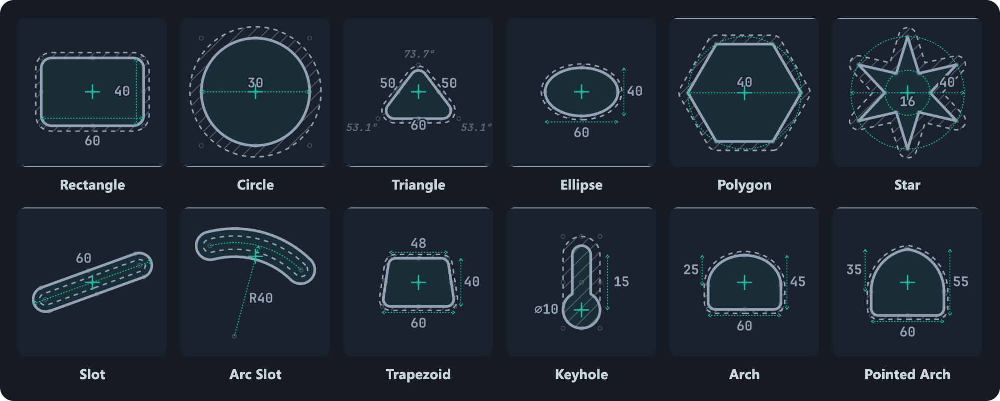
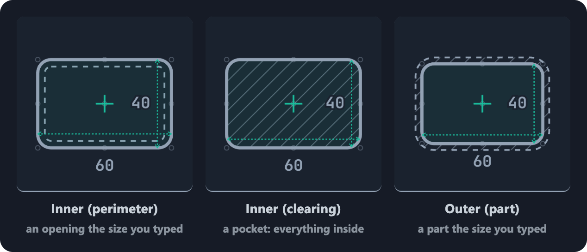
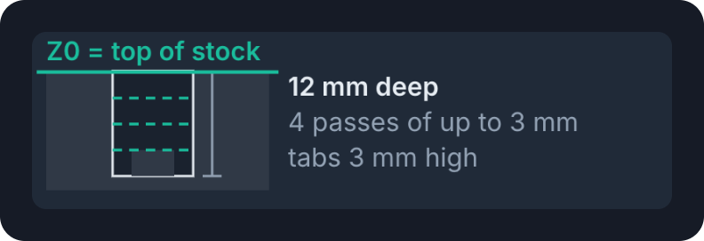
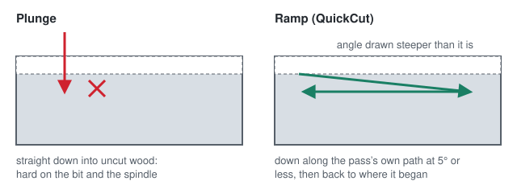
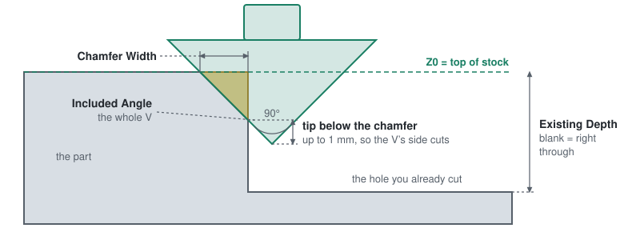
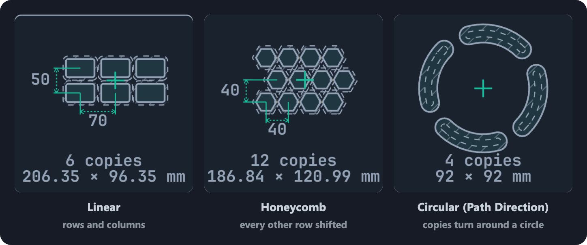
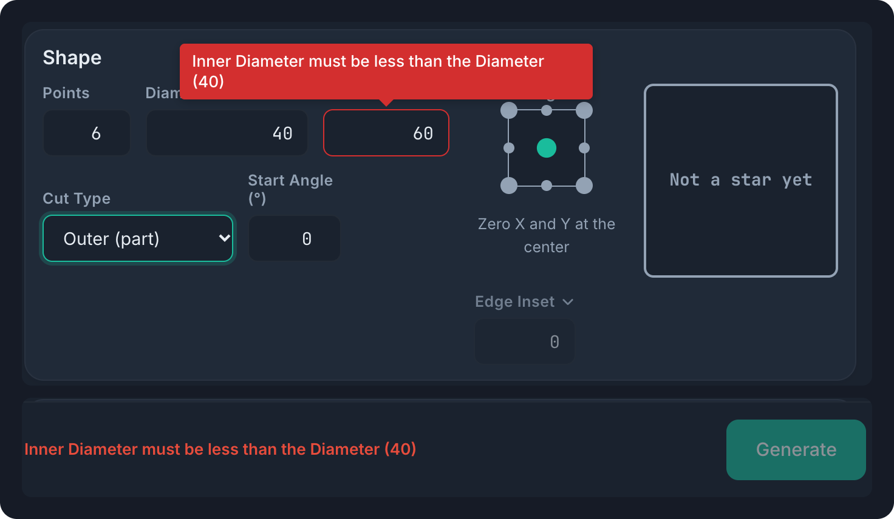

# QuickCut

Quick G-code for the everyday CNC jobs (shapes, holes, surfacing, edge work) straight from a dialog in ncSender. For the times you'd otherwise open your CAM program just to cut one rectangle, flatten a spoilboard, or true up a rough edge.



## Contents

- [Install](#install)
- [Quick start](#quick-start)
- [Shapes](#shapes)
- [Setting up a cut](#setting-up-a-cut): [cut types](#cut-types), [previews](#the-previews), [origin and inset](#origin-and-inset), [depth](#depth-and-passes), [entering the cut](#entering-the-cut), [holding tabs](#holding-tabs), [corner relief](#corner-relief), [chamfer](#chamfer), [patterns](#patterns)
- Shapes in detail: [Slot](#slot), [Keyhole](#keyhole), [Drill](#drill)
- [Tools: Planer, Jointer, Cutter](#tools-planer-jointer-cutter)
- [Recipes](#recipes)
- [Tool, feeds and spindle](#tool-feeds-and-spindle)
- [Problems and the run note](#problems-and-the-run-note)
- [Measuring an angle](#measuring-an-angle)
- [Typing units](#typing-units)
- [Help inside QuickCut](#help-inside-quickcut)
- [Saving and loading programs](#saving-and-loading-programs)
- [Development](#development)

## Install

Install it from ncSender's **Plugin Manager**. Or unzip a release into ncSender's plugins folder, in a folder named `com.ncsender.quickcut`:

| System | Plugins folder |
| --- | --- |
| Windows | `%APPDATA%\ncSender\plugins\` |
| macOS | `~/Library/Application Support/ncSender/plugins/` |
| Linux | `~/.config/ncSender/plugins/` |

Then open it from ncSender's tool menu.

## Quick start

Cut a 120 × 80 mm part out of a sheet, with 6 mm round corners:

1. Zero X and Y where you want the part's center, and Z on the top of the stock.
2. Open QuickCut. On the **Rectangle** tab, set the **Bit Diameter** and pick the **Material**: the feeds and speeds fill in.
3. Set **Width** 120, **Height** 80, **Corner Radius** 6, and **Cut Type** to **Outer (part)**.
4. Set **Total Depth** a little more than the stock is thick, and turn on **Holding Tabs** so the part can't come loose.
5. Check the preview and the note beside **Generate** (about how long it runs, and whether it fits the machine's travel).
6. Press **Generate**. The program loads into ncSender's visualizer, ready to check and run.

## Shapes



The shapes are a grid of icons in the sidebar, simplest first, with related shapes side by side. Some icons open the same tab with a different shape picked: Trapezoid, Triangle, Arch and Ellipse are kinds of the Rectangle tab (they share its settings, and its title is a menu of them), Star is a kind of Polygon, Pointed Arch is Arch with the pointed top, and Arc Slot is Slot with **Slot Type** on Arc. Drill, Planer, Jointer and Cutter are under **Tools**.

| Shape | Cut types | Corner Radius | Corner Relief | Holding tabs | Chamfer | Pattern |
| --- | --- | :---: | :---: | :---: | :---: | :---: |
| Rectangle, Trapezoid, Triangle | Inner (perimeter), Inner (clearing), Outer | ✓ | ✓ | ✓ | ✓ | ✓ |
| Arch | Inner (perimeter), Inner (clearing), Outer | front corners | | ✓ | ✓ | ✓ |
| Ellipse, Circle | Inner (perimeter), Inner (clearing), Outer | | | ✓ | ✓ | ✓ |
| Polygon | Inner (perimeter), Inner (clearing), Outer | ✓ | ✓ | ✓ | ✓ | ✓ |
| Star | Inner (perimeter), Outer | | | ✓ | ✓ | ✓ |
| Slot, Arc Slot | Center line, Inner (perimeter), Inner (clearing), Outer | | | ✓ | ✓ | ✓, and Grid |
| Keyhole | one pass with a keyhole bit | | | | | ✓ |
| Drill | holes the size of the bit | | | | ✓ | ✓ |

Every shape has an [Origin and Inset](#origin-and-inset), and all but Circle can be turned: a Start Angle, or a slot's or keyhole's own angle (twist the [preview](#the-previews)).

- **Rectangle:** **Width** × **Height**, with an optional **Corner Radius**. **Start Angle** turns it about its center (counter-clockwise).
- **Trapezoid:** a **Bottom Width** and a **Top Width**, Height apart; the top centered or lined up with either end. Corner Radius rounds all four corners, up to what the shape has room for (the header says when it's capped).
- **Triangle,** **Defined By** what you know: **3 Sides**, **2 Sides + Angle**, **Base + 2 Angles**, or **Base + Height** (the peak centered, over either end, or a set distance along). The preview shows every side and angle, the ones worked out fainter, and switching Defined By keeps the triangle.
- **Arch:** straight sides under a **Round** top (half an ellipse) or a **Pointed** one (two arcs meeting at a point, like a church window; it must rise at least half the Width), of a set **Rise**. Height includes the rise. Corner Radius rounds the two front corners.
- **Ellipse:** an oval, Width × Height. Curves are cut as short straight moves within 0.01 mm of the curve.
- **Circle:** **Diameter**. It ramps down in a helix and finishes with one more lap at full depth.
- **Polygon:** 3 to 12 sides, sized **Across Corners**, **Across Flats** or by **Edge Length** (pick it in the menu over the size; switching converts the number). Corner Radius rounds every corner, up to fully round.
- **Star:** **Points**, the **Diameter** across them, and the **Inner Diameter** the corners between them sit on (smaller for sharper points). Start Angle 0 points the first point to the back.
- **Slot** and **Arc Slot:** a slot with round ends, straight or curved; see [Slot](#slot).
- **Keyhole:** a hanging slot cut with a keyhole bit; see [Keyhole](#keyhole).
- **Drill:** holes the size of the bit, with optional pecking; see [Drill](#drill).

## Setting up a cut

### Cut types



- **Inner (perimeter)** cuts just inside the outline, for an opening of that size.
- **Inner (clearing)** removes everything inside (a pocket), stepping over by **Stepover** (% of the bit). Each ring is a full lap.
- **Outer (part)** cuts just outside, so the piece inside comes out at full size.

The bit's diameter is allowed for: the size you type is the size you get. In the previews the solid outline is that size; for Inner (perimeter) and Outer, a fainter dashed line a bit diameter inside or outside it marks the cut's other edge, so the band between them is what the bit takes. The hatch shows what the bit removes: that band on an Outer cut, the whole inside on Inner (clearing). An inside corner can't be tighter than the bit's radius; when the bit rounds the corners more than you asked, the preview shows your shape dashed behind the cut.

### The previews

Every shape's preview is drawn from the same code as Generate, and updates as you type. A crosshair marks X0 Y0.

- **Twist** a preview with a finger or the mouse to turn the shape (Start Angle, or a slot's angle). It moves in half degrees, snaps square (0, 90, 180, 270°) within 5°, and sticks within a degree of the common miter angles: 180/n for n = 3, 4, 5, 6, 8, 10 and 12 (60, 45, 36, 30, 22.5, 18 and 15° and their multiples).
- **Tap** a point of the shape to make it X0 Y0: a corner, the middle of an edge, a quadrant point of a circle, a star's point or inner corner, a slot's end, an arc's center. The points follow the Start Angle, so a turned shape's own corners can be X0 Y0. With a pattern on, they belong to the first copy.
- **Click a blank spot** to enlarge the preview over the dialog; click a blank spot again or press **Esc** to go back (Esc only closes QuickCut when nothing is enlarged). Taps and twists work in the enlarged view too, and while you twist, the field being set and its value (e.g. **Start Angle 22.5°**) show in large type at the top. When X0 Y0 sits on a detail too small to see (a thin slot's edge, a small hole, a small inset or corner radius), a magnified view in a corner of the preview shows it, and its points can be tapped too.

### Origin and inset

The **Origin** dots pick which point is X0 Y0: a corner, an edge midpoint, or the center of the box around the cut. With a pattern on, it's that point of the box around *all* the copies. Tapping the preview instead picks a point of the shape itself (above).

**Inset** keeps the cut that far in from a corner or edge origin, toward the shape, without moving the work offset:

- From a **corner** it moves both ways: front-left moves the cut +X and +Y, back-right −X and −Y. From an **edge** midpoint it moves across that edge only.
- It doesn't apply to the **center**, a tapped point, or Keyhole's plunge hole, and is greyed out there.
- A **negative** inset moves the cut that far *out* past the origin instead, e.g. to [round a stock corner](#round-a-stock-corner).
- The **Inset** label is a menu. **Edge Inset** is to the edge of the cut; **Center Inset** is to the copies' centers instead, e.g. the first of a row of holes 10 mm in from the corner whatever the bit (Drill starts on Center Inset). The **XY** choices split it into two boxes, X for a left or right origin point and Y for a front or back one. Switching converts the numbers so nothing moves.
- The previews show it as a short dashed dimension from the crosshair to the cut. The program header notes it: `Origin: front-left, inset 10mm`, or `inset X 10mm, Y 4mm`, with `to centers` for Center Inset.

With a pattern, the inset applies to the box around all the copies, so a grid of holes can start a set margin in from the stock's edges.

### Depth and passes



Zero Z on the top of the stock: **Total Depth** is measured down from it, in passes no deeper than **Depth of Cut**. To cut right through, make Total Depth a little more than the stock is thick (about 0.5 mm, or 0.02 in, into the wasteboard): sheet goods are seldom exactly their nominal thickness. The Depth card draws a side view of the passes (the same split the G-code uses) and the tabs, and every program's header says where Z0 goes.

### Entering the cut



Every pass of a profile, slot or pocket ramps down instead of plunging into uncut wood, which is easier on the bit and the spindle:

- **Ramps:** from the last pass's floor, down along the pass's own path and back to where it began, at 5° or less. Down off each holding tab too, from the last pass's floor.
- **Short paths:** a path too short for 5° goes back and forth, up to 8 times, then steeper, with the feed slowed so Z never comes down faster than the **Plunge Rate**. A path under 1 mm (0.04 in), such as a hole barely bigger than the bit, plunges at the Plunge Rate.
- **Circles** spiral down (a helix), with as many turns as keep it to 5°, and a Rectangle pocket starts with a small helix in its middle.
- **Drill** and **Keyhole** plunge, by design: a drill bit cuts on its end, and a keyhole bit can only go in through its hole.

### Holding tabs

A through cut frees the part (or the drop-out of an inner cut) on the last pass, where it can shift into the bit. Turn on **Holding Tabs** in the Depth card to leave small bridges that hold it until you cut them with a knife or saw.

- **Tabs** is how many per shape, **Tab Width** is each tab's width at the part edge, and **Tab Height** is how much material each tab leaves standing above the bottom of the cut. Tab Height has to be less than Total Depth.
- A pass is added at exactly Total Depth − Tab Height, so tabs come out at the height you set. Passes below that lift over each tab; passes above it are unchanged.
- On the toolpath each tab spans Tab Width + Bit Diameter, because the bit takes a radius off each side of the tab.
- Tabs go on straight edges rather than corners: each side gets a share by its length, centred along it, so 4 tabs on a rectangle give one in the middle of each side. A circle's tabs are evenly spaced, and so are any that don't fit on the sides. Tabs that won't fit at all (too many, too wide) are dropped, with a warning in the G-code.
- Tabs apply to Inner (perimeter) and Outer cuts. They're hidden for clearing, which never frees anything, and for a Slot's Center line cut.
- The previews show where the tabs will be. With a pattern, every copy gets its own tabs, and they turn with the copy.

### Corner relief

A round bit can't cut a sharp inside corner, so a square-cornered part won't drop into an Inner cut. **Corner Relief** (Rectangle, Trapezoid, Triangle and Polygon, Inner cuts) fixes that:

- **Dog-bone** runs the bit diagonally into each corner and back.
- **T-bone** runs it straight on along one edge, so only the other wall is notched, which hides better on a visible joint: on a Rectangle along the longer edges (notches in the end walls); on a Polygon each edge runs on past its end in the cut's direction, all the way round like a pinwheel.

Either way its edge reaches the corner, or the Corner Radius when that's smaller than the bit, and the preview shows the notches. It applies to every depth pass and the last lap of a clearing. None by default.

### Chamfer



The **Chamfer** tab (Drill's holes, every shape, and the edge a Cutter program leaves) turns the program into a chamfer of the top edge you've already cut, with a V-bit, in place of the cut: inside a hole's edge, outside a part's. Run the cut first, and clear the hole or slot out. Generate becomes **Generate Chamfer**.

- **The V-bit is the Tool card's bit.** With a tool changer, a V-bit in the spindle turns Chamfer on (any other bit turns it off), and picking a tool in the Bit Diameter menu does the same, saying so; the program starts with its `M6`. **Included Angle** is the whole V (90 for a bit that is 45° a side), filled from the tool table's taper angle or the tool's name. Without a tool changer, the switch stays as you last set it and the Tool card's label reads **V-Bit Diameter**.
- **Chamfer Width** is across the top, as in Fusion 360's 2D Chamfer; with a 90° bit it's the C on a drawing (C1 = 1 × 45°). Up to 90% of the V-bit's radius: the very edge of the V is its weakest.
- **The cut already made:** **Existing Depth** (blank: right through) and **Cut Bit**, the bit it was made with. A pocket's inside corners are as round as that bit, and the chamfer follows them, so the tip never runs into them; around a part it's the slot's width. Cut Bit is hidden where it can't matter (inside a circle, a slot or an ellipse). On Drill, the card asks for the **Hole Diameter** instead, and the Feed Rate comes back on for the chamfer's laps. Its **Method** (on Drill and an Inside circle) can be **Plunge**: straight down at each hole's center, like a countersink, until the V's cone meets the chamfer's edge. That's quicker, but the V-bit has to be wider than the hole and chamfer, and the tip goes deeper (at 90°, the hole's radius below the chamfer); keep the Origin and pattern the drill program used, so each chamfer lands on its hole. On Cutter it bevels the kept piece's edge along the cut, out and back, with the same XY zero edge, Target Size and Cutting Length (Cut Bit is the cut's width). On Keyhole it asks for the **Keyhole Bit** (its head) and its **Neck** (blank: half the head), and the chamfer goes round the opening at the surface: the head's hole and the neck's slot.
- **Tip offset, worked out for you:** the tip goes below the chamfer, into that cut, so the V's side cuts rather than its weak tip: up to 1 mm (0.04 in), clear of the bottom by 0.2 mm (0.008 in), no lower than the chamfer is deep on a through cut, and in a pocket no farther in than its narrowest part allows. Around a part, the V's other side stays off the slot's far wall. The header and the note give the deepest Z. Generate won't make a program it can't cut, and the note beside Generate says why first.
- **Passes** by the card's own **Depth of Cut**, each taking about as much material as the last, ramped in along the path like any other pass. Total Depth and the tabs belong to the cut, so they're hidden while chamfering.
- Corners the Corner Radius doesn't round (a star's points and the corners between them, an arch's top) are rounded in the chamfer as the Cut Bit rounded them. A Center line slot is as wide as the bit that cut it, so the card asks for that Cut Bit.

### Patterns



Turn on the **Pattern** switch to cut several copies in one program. The spindle and coolant start once; each copy gets its own approach, ramp, and retract. The **Origin** applies to the box around the whole pattern.

| Style | What it does |
| --- | --- |
| Linear | A grid of rows and columns. |
| Honeycomb | Like Linear, but every other row is shifted half a step along it. **Y Count** and **Y Spacing** are row by row, shifted rows included, starting with an unshifted row. **Symmetric Ends** drops one copy from each shifted row so both ends line up. Programs from before Y Count was row by row load as the same layout. |
| Circular (Identical) | *Count* copies on a circle of *Radius*, starting at *Start Angle* and spread over *Total Angle*. Every copy keeps the same orientation. On Circle and Drill, where turning makes no difference, this is just **Circular**. |
| Circular (Path Direction) | The same, but each copy turns with the circle: the first copy (at the Start Angle) looks like the shape preview, and each later copy is turned by how far round it is. |
| Grid | Straight slots only: lines instead of copies; see [Slot](#slot). |

**Spacing, Extent, Overall or Gap.** On Linear and Honeycomb, the X and Y Spacing labels are menus; each direction has its own:

- **Spacing:** center to center between neighbouring copies.
- **Extent:** from the first copy's center to the last, and the copies spread evenly over it, like the Extent option in a CAD linear pattern. X Count 5 with X Extent 400 puts them 100 apart; change the count and they re-space to fit the same 400.
- **Overall:** from the outer edge of the first copy to the outer edge of the last, so every copy fits inside it.
- **Gap:** the stock left between neighbouring copies' cuts at their closest, edge to edge (on an Outer cut, between the parts themselves). The spacing then follows the shape and the bit: resize the shape and the gap stays. On Honeycomb, **Row Gap** is to the nearest copy in the next row, so equal gaps give an even web, e.g. hexagons nesting with a constant wall.

Switching converts the number so the copies stay put, and a negative number runs the copies the other way from the origin. The preview measures what the menus set in green, and the header gives both, e.g. `Pattern: Linear 5x1 [extent X=400, Y=0; dX=100, dY=0]`.

**At an angle.** Linear and Honeycomb have an **Angle (°)**, counter-clockwise from +X; the **Measure** link beside it [measures it on the machine](#measuring-an-angle). At any angle but 0 the whole grid turns about the first copy, and the fields become **Count** (copies per row), **Spacing** (along the row), **Rows** and **Row Spacing** (at right angles to the row). For example, 5 circles at 36° with a spacing of 20 puts every center exactly 20 apart on a 36° line. Rectangles (and their kinds), polygons, slots and keyholes also get **Rotate shapes**: off, each copy stays square to the machine; on, it turns to sit square to the row. Circles and holes look the same either way.

**Circular.** **Total Angle** (default 360°) is the arc the copies are spread over, counter-clockwise from the Start Angle: 360° spaces them evenly all the way round; less puts the first and last copy at the ends of the arc (5 copies over 90° are 22.5° apart); negative runs clockwise. The **Radius** label is a menu: **Center Radius** is to each copy's center; **Inside Radius** is to the nearest edge of any copy, the clear circle left in the middle (e.g. around a center hole); **Outside Radius** is to the farthest edge, so the pattern fits in a circle that size. The header adds `total=90°` when it isn't 360.

**The pattern preview** shows every copy as you type, each with its own outline, so you can see the stock left between parts, and the pattern's overall size under the copy count. Where copies overlap, the overlap is tinted yellow: holes or pockets running into each other, or an Outer cut eating into the next part. Twist it to turn the Angle (Circular: Start Angle). Above 500 copies it shows only where each copy starts; above 3000 it shows the count. Tapping a point on the shape preview still picks a point of the first copy, so every dot there stays useful with a pattern on.

## Slot

A slot with half-round ends: an adjustment slot for a bolt, a slot for a track or a fence, or a curved slot for a tilting table or a router-lift trunnion.

- **Straight:** **Length** is overall, from end to end including the round ends, at **Angle** (counter-clockwise from +X). **Width** is the finished width.
- **Arc**, by **Radius & Sweep:** **Radius** is from the arc's center to the middle of the slot. The slot starts at **Start Angle** (counter-clockwise from +X) and runs **Sweep** degrees counter-clockwise, or clockwise if negative.
- **Arc**, by **Chord & Rise**, for when you can measure the ends but not the center: **Chord** is the straight distance between the centers of the two ends, **Rise** how far the middle of the slot bulges out from that line, and **Angle** the direction it bulges toward (90° = toward the back). The program header gives the radius and angles they work out to: radius = (chord² / 4 + rise²) / (2 × rise).
- **Cut Type:** **Center line** runs the bit once along the middle of the slot, so the slot is the bit's width (Width is greyed out), each Depth of Cut pass going the other way along it. **Inner (perimeter)** cuts round the inside of the outline; **Inner (clearing)** clears it with rings out from the center line, **Stepover** apart; **Outer (part)** cuts round the outside, for a slot-shaped part.
- **Picking X0 Y0:** tap an **end** of the slot (its center) or an arc's **center**. On a straight slot you can also tap a **corner** (where a long side meets an end) or the **middle of a long side**, at any angle; on a Center line cut that puts that edge of the cut on X0 Y0. On a thin slot those points are close together, so a tap just outside a long side snaps to it: beside its middle third for the side's middle, toward an end for that corner. The 9-dot picker's points are the box around the slot, which includes the bit.
- On an arc the inner edge is cut with clockwise arcs (G2), the rest counter-clockwise (G3).
- A slot that can't be cut is caught before Generate, at the field to change: an arc as wide as its radius, ends that would overlap (Chord shorter than the Width, or a Sweep too close to a full circle), an inner cut no wider than the bit, or an Outer arc cut whose ends wouldn't join.

**Grid** pattern (straight slots): a grid of grooves, e.g. a decorative grid or a waffle board.

1. Choose **Straight** as the Slot Type and **Center line** as the Cut Type (one bit-wide groove per line).
2. Turn on **Pattern** and choose **Grid**.
3. Set **Columns** and **Column Spacing** (the lines running front to back, spaced along X) and **Rows** and **Row Spacing** (the lines running left to right, spaced along Y). Pick **Width** / **Height** in a spacing label's menu to give the grid's overall size that way instead.
4. Optionally set a pattern **Angle** to turn the whole grid.

How it's cut: every line spans the grid, so the outer lines meet at the corners (with 4 columns 20 apart and 3 rows 30 apart, the rows and columns are all 60 long). The Slot's own Length and Angle don't apply (they're greyed out). The rows are cut first, then the columns, each line to full depth before the next, going back and forth so each line starts near where the last one ended. The **Origin** and **Inset** use the box around the whole cut, including the bit's width, so with a corner or edge origin the outer lines sit one bit radius in from X0 Y0. For a V-bit, see [the recipe](#a-grid-of-v-grooves).

## Keyhole

Cuts a hanging slot with a keyhole (T-slot) bit, the kind used to hang a sign or picture on a screw. The bit's head is wider than its neck, so it can only enter and leave the wood through the plunge hole:

1. Plunge straight down to **Total Depth** at the Plunge Rate.
2. Cut forward **Slot Length** along **Slot Angle** (counter-clockwise from +X; 90° runs toward the back, +Y).
3. Retrace exactly back to the plunge hole.
4. Retract.

- Set **Bit Diameter** to the bit's head diameter. It starts at a 3/8" keyhole bit (10 mm on a metric install).
- **Slot Length** (hole centre to slot-end centre) starts at 1.5 times the bit. Its label is a menu: **Slot Length** is a distance, which changing the bit leaves alone; **Slot Ratio** is a multiple of the Bit Diameter, so the slot follows the bit. Switching converts the number so the slot stays the same, and Load restores the mode.
- There's no Depth of Cut: the slot is always one pass at full depth, because a shallower pass would cut the narrow neck slot out to the full head width. Total Depth is to the bottom of the head.
- In the preview the solid outline is the keyhole at the surface (the plunge hole joined to the narrow slot the shank leaves, drawn at half the head's width) and the dashed outline is the head's path under it. Twisting it snaps to 0°, 90°, 180° and 270° within 5°.
- **Origin:** X0 Y0 starts at the plunge hole (the first one, when a pattern is on); tap it on the preview to go back to it. The Origin picker's dots are the box around the whole cut.
- With **Circular (Path Direction)**, or **Rotate shapes** on an angled Linear pattern, each slot turns with its copy.

## Drill

Plunges a hole the size of the bit, or one at every position of a [pattern](#patterns): shelf-pin rows, threaded-insert grids, pilot holes.

- Hole diameter is the **Bit Diameter**. Every Z move uses the **Plunge Rate**; Feed Rate isn't used and is greyed out.
- **Peck Depth** 0 drills in one plunge. Otherwise each peck goes that much deeper, then:
  - **Full (clear chips)** rapids up to 2 mm (0.079") above the surface to clear chips, then rapids back down to 0.5 mm (0.02") above the bottom of the hole and continues.
  - **Short (break chips)** backs off 0.5 mm (0.02") to snap the chip and continues.
- **Dwell at Bottom** pauses at full depth to clean up the hole floor.
- **Origin** works as on Circle: the center (the default) puts a single hole at X0 Y0; with a pattern, each point is a corner, edge midpoint, or the center of the box around all the holes.
- With a pattern you can also **tap a hole in the preview** to make that hole X0 Y0: it's filled in, the crosshair moves onto it, and the 9 dots go blank (tap a dot to go back). The hole is remembered by its column and row (or its number on a Circular pattern), so it stays the same hole when you change a count; if the pattern no longer has it, the origin falls back to the center. Past 2500 holes (50 × 50) the preview just shows the count; you can still generate.

The moves are written out in full rather than as G81/G83 canned cycles, which plain grbl doesn't support and which the visualizer wouldn't show.

## Tools: Planer, Jointer, Cutter

**Planer** surfaces a flat region with zigzag strokes (along X or Y) or a spiral from the outside in. **Stepover** is the % of the bit each stroke moves over, and **Overrun** carries the cut past every edge so the boundary is flat too. Three modes:

- **Target Depth:** flatten an uneven top. Z0 on the top surface, cutting down Total Depth.
- **Target Thickness:** Z0 on the wasteboard; enter the stock's **Starting Thickness**, and it refuses a thickness that would cut into the wasteboard.
- **Wasteboard Surfacing:** the machine's whole travel (from grblHAL `$130`/`$131`), kept a bit radius inside it. It's placed where the travel really is, from the homing settings: 0 to the travel on an axis that homes to its minimum with `$22` "Set machine origin to 0", otherwise minus the travel to 0 (the usual grbl machine space). Without grblHAL's `$22` names, or with homing off, it assumes 0 to the travel. The hint shows the range it found. With a keepout zone on (ncSender Pro's, or the ATCi tool rack's `$684`–`$687` with `$683` Enable), **Avoid Keepout Zone** leaves out each zone plus the bit radius, lifting to machine safe Z between the areas around them; a zone outside the travel is named as not avoided.

**Jointer** makes a straight reference edge: it takes **Trim Width** off the edge **# of Trims** times, along **Trim Axis**, for **Length** plus **Overrun** at each end. Every stroke runs the same way, so **Cut Direction** stays true: **Conventional** is the safer default; **Climb** leaves a cleaner edge but needs a rigid machine and well-held work. **Both Ways** alternates the trims to save the trip back (every other one climbs). Tap an arrow in the preview to switch.

**Cutter** is a cold-saw-style parting cut: one line **Target Size** in from the chosen edge (the bit radius is allowed for), so what you keep is that size. Tap an edge in the preview to choose it; X0 Y0 is on that edge. Multiple depth passes keep the load on the bit down; **Both Ways** alternates them to save the trip back.

## Recipes

### Cutting board juice groove

A groove 10 mm in from the edges of a 300 × 200 board: zero X/Y on the board's front-left corner, then a Rectangle 280 × 180, Inner (perimeter), Origin front-left, Inset 10. A second run with Inset 0 and Outer (part) at 300 × 200 cuts the board to its final size from the same zero.

### Round a stock corner

Zero X/Y on the corner. Then a Slot: Arc, **Radius** = corner radius + bit radius, **Start Angle** facing the corner (front-left 180, front-right 270, back-right 0, back-left 90), **Sweep** 90, **Center line**, that corner as the Origin, and **Inset** = minus the bit diameter. The bit's centre runs a bit radius outside the finished edge, starting and ending a bit radius outside the two stock edges, level with the tangent points, so the round blends into them. E.g. a 10 mm round with a 6 mm bit: Radius 13, Inset −6. (The Origin box includes the bit's own width on a Center line cut, which is why the inset is a whole bit diameter.)

### A grid of V-grooves

Set up a [Grid](#slot) with a V-bit, then set **Inset** to the negative bit radius (e.g. −3.175 for a 6.35 mm / ¼" V-bit, using the Bit Diameter you entered) so the first row and column run exactly along X0 and Y0, not a bit radius inside them. A V-bit's groove width depends on depth, so placing the line centres on the origin is what you usually want. Before cutting stock, air carve it: zero Z above the work, run the program, and check that the first lines and the grid's extent start where you expect.

### A ring of arc slots

An Arc Slot with a **Circular (Path Direction)** pattern of **Radius 0**: each copy turns about the arc's own center. 4 copies with a 90° Sweep make a full circle; a smaller Sweep leaves gaps between them (the pattern preview above uses 60°). A Radius above 0 puts each arc's center on that circle instead.

## Tool, feeds and spindle

- **Starting feeds:** pick the **Material** (MDF / Plywood, Softwood, Hardwood, HDPE / UHMW, Acrylic, Polycarbonate, Aluminum, Foam / tooling board) and the bit's **Flutes** in the Tool card, and QuickCut fills Spindle RPM, Feed Rate, Plunge Rate, Depth of Cut and Stepover from the Bit Diameter, within the machine's max feed (`$110`/`$111`) and spindle range (`$30`/`$31`). A new Bit Diameter gets its own feeds until you change them by hand, and a new install starts with MDF / Plywood's. The **Material** label is a menu of how hard they push: **Average**; **Conservative** for a light machine, a long bit or a first try (Feed Rate and Plunge Rate ×0.75, even when the machine's max holds them, and Depth of Cut and Stepover ×0.75; on plastics and aluminum the feed stays, since a thinner chip melts or rubs); or **Aggressive** for a rigid machine (Feed Rate and Plunge Rate ×1.25, up to the material's chip limit and the machine's max feed, and Depth of Cut and Stepover ×1.2: about 1.5 to 1.8 times the load). RPM stays the same, Plunge Rate stays within the Z axis's max rate (`$112`), and the choice is kept for every tab. A starting point: listen, look at the chips, and adjust. Inspired by [ncCAM](https://github.com/siganberg/ncsender-plugin-nccam)'s tool-aware material selector, whose formula it uses.
- **Bit Diameter from the tool table:** click its label to fill in the loaded tool's diameter. With ncSender's tool changer on (Settings › Tool Changer), the label is a menu of the tool table instead: the tool in the spindle first, with a filter to find one; picking a tool sets the diameter and flutes, and starts the program with `M6 T<n>`. The M6 is written only while the tool table still has that tool at that diameter.
- **Spindle:** **Delay** waits after starting the spindle so it reaches speed. **Mist** and **Flood** turn on coolant (M7 / M8).
- **Tool summary:** the Tool and Spindle cards scroll with the tab; once they're out of view, one line at the top sums them up, and tapping it goes back up to them.
- **Units** follow ncSender's units setting (metric or imperial), and **Safe Z** follows its `safeZHeight` setting, or machine Z0 when it's unset.
- Each tab remembers its own settings, and the values you last generated with.

## Problems and the run note



- A field that can't be used gets a **red border**, and a **red bubble** over the field you're in (or just left) says why. The bubble never moves the cursor and stays until the field is fixed, so you can fix two fields that depend on each other in either order.
- The note beside **Generate** shows the first problem, with "(+N more)" when there are others; tap it to go to that field. Generate dims until everything is fixed, and pressing it takes you to the first problem.
- Once the tab is ready, the note says about how long the program runs and, when the machine is homed, whether it stays inside the machine's travel (`$130`/`$131`) from the active work offset's X0 Y0: "About 3 min. Fits the machine's travel from G54's X0 Y0." Past an edge it turns red and says by how much. Set X0 Y0 first for a true check.

## Measuring an angle

The **Measure Pattern Angle** page shows the angle and distance of a line from the work origin (X0 Y0) to a second point on it, to match a pattern to a line on the workpiece, such as an edge that isn't square to the machine. Open it with the **Measure** link beside a Linear or Honeycomb pattern's **Angle (°)** field; the page title names the shape it was opened from.

1. Jog to a point on the line and zero X and Y in your work coordinate system.
2. Set the **Second Point Coordinate** further along the same line (farther apart gives a more accurate angle): jog to it and press **Grab Current**, or type its work X/Y. The point only changes when you type or grab, so jogging afterwards doesn't change the angle, and it's remembered for next time. Clear both fields to forget it.
3. Read the **Angle** (counter-clockwise from +X, between −180° and 180°) and **Distance**.
4. Press **Use …° for** *shape* to put the angle in that shape's pattern and go back to it. **Back** returns without changing anything.

Below the result, **Live machine position** shows the current work, machine, and origin (WCO) X/Y, about twice a second, for reference. ncSender reports positions in mm and assumes the controller does too (grblHAL `$13=0`); with `$13=1` the angle is still correct, but the distance and coordinates are not.

## Typing units

Size, depth, distance, and feed fields accept a unit. When you leave the field, it's converted to a plain number in the units QuickCut is using (inches with G20, mm with G21):

| You type | Metric shows | Imperial shows |
| --- | --- | --- |
| `.25in`, `.25"`, `1/4"`, `0.25 inch` | 6.35 | 0.25 |
| `6.35mm`, `0.635cm` | 6.35 | 0.25 |
| `1-1/2"` or `1 1/2 in` | 38.1 | 1.5 |
| `5/4"` (fractions over 1 work too) | 31.75 | 1.25 |
| `1/4` (no unit) | 0.25 | 0.25 |
| `100ipm`, `100 in/min` (feed fields) | 2540 | 100 |
| `2540 mm/min` or `2540mm/m` (feed fields) | 2540 | 100 |
| `25mm/s`, `25 mm/sec` (feed fields) | 1500 | 59.0551 |
| `1ips`, `1 in/s` (feed fields) | 1524 | 60 |
| `8mm*2`, `1in+4mm`, `(1/4"+2mm)/2` (simple math) | 16, 29.4, 4.175 | 0.6299, 1.1575, 0.1644 |
| `1,5mm` (a decimal comma; `1,000` is refused, as it may be a thousands separator) | 1.5 | 0.0591 |

Math takes + - * / and brackets; a number with no unit is in the current units when it's added or subtracted, and a plain factor when it multiplies or divides. A dash with no spaces is a mixed number (`1-1/2` is 1.5); with spaces it subtracts (`1 - 1/2` is 0.5). Feeds are always per minute, so per-second entries are multiplied by 60, and `/m` means per minute. A number with no unit is taken to be in the current units already. Text that can't be read is left as typed, and the field says it must be a number. Counts, angles, RPM, and percentages are plain numbers.

**Arrow keys:** with a keyboard, Up / Down Arrow steps any number field, in the units shown. Unit text such as `1/4"` is converted first, so Up turns it into 7.35 in metric. Count fields always step by at least 1, and a step below a field's minimum stops at it if it's a whole number, so Down from 1 mm never lands on an odd minimum like 0.1 mm.

| Keys | Step |
| --- | --- |
| Up / Down | 1 |
| Shift + Up / Down | 10 |
| Alt (Option) + Up / Down | 0.1 |
| Ctrl (Command) + Up / Down | 0.001 |

## Help inside QuickCut

The **Help** button at the bottom of the sidebar explains the tab you're on: what its settings do, every field's tip (the ones that otherwise only show when you hover with a mouse, so touchscreen users can read them too), and the shared notes on patterns, the tool and typing units. **All help topics** lists every tab with a line on what it does. **Back** returns to the tab with everything as you left it. The first time QuickCut opens in a browser, it starts on All help topics.

On a touchscreen, touch a field (or tab to it) and wait a second to see its tip just below it, like a mouse hover would. The **Touch Tooltips** switch at the top right of Help turns them off.

The [ncSender manual's QuickCut page](https://docs.ncsender.xyz/plugins/quickcut/) has more.

## Saving and loading programs

Every program QuickCut generates ends with its settings: a few comment lines after `M30`, under `(QuickCut settings - used by Load)`. The readable summary at the top and the G-code itself are unchanged.

- Turn on **Save to File Manager** to keep each program in File Manager › QuickCut. Each is named after what it cuts: the shape, its main sizes as short tags, the depth, the cut type, any pattern, and the units, e.g. `QuickCut-Rectangle_W-120_H-80_R-6_D-6_Outer_P-3x2_mm.nc`. A name that's already taken gets " (2)", " (3)" and so on.
- **Load**, at the top right of each tab, lists those programs, newest first, with a filter box. Pick one and QuickCut switches to that program's tab and fills it with the values it was made with: shape, depths, tool, origin and inset, holding tabs, pattern, spindle and coolant. Nothing is generated or run; check the values (your bit may differ) and press Generate.
- **Merge**, beside Close in Load, combines saved programs into one to run again: tap Merge, tick the programs in the order to cut them (each box shows its place), and tap **Merge N programs**. After you confirm, it saves `QuickCut-Merge_N-programs.nc` in File Manager › QuickCut and loads it. Each program keeps its own header, units, tool change and spindle start; only the last one ends the program (`M30`), and a tool change to the tool already in the spindle is left out. A program with no tool change of its own, after one that changed tools, starts with a pause (`M0`) to check the bit. A merge has no settings of its own, so Load says to run it from File Manager instead. Every program cuts from the same X0 Y0 and Z0, so make the parts with origins that fit together; the confirm warns when their Z0 differs (the Planer can set it on the wasteboard). Esc stops ticking without closing Load.
- To share a setup, share the program file: anyone who puts it in their File Manager › QuickCut folder can Load its settings, change what they need, and regenerate.
- Programs made before this feature, or by other software, have no settings and say so. The settings are stored in mm, so a program made in inches loads correctly in metric and the other way round.
- The comment lines are kept under 70 characters because ncSender sends comment lines to the controller as well; GRBL and grblHAL ignore them.

## Development

```
npm test       # run node --test on the extracted generators
```

Generators live in two places on purpose:
- `config.html`: the copy the browser dialog runs (ncSenderPro V2's plugin server serves this HTML directly; external `<script src>` won't resolve)
- `lib/*.cjs`: the Node-loadable twin used by tests, kept in sync by hand

Every fix to a generator must be applied to BOTH. The starting feeds (`startingFeeds` in `config.html` and `lib/starting-feeds.cjs`, checked by `tests/starting-feeds.test.cjs`) follow [ncCAM](https://github.com/siganberg/ncsender-plugin-nccam)'s `src/core/tools.js`: the chip each tooth takes grows with the bit up to a cap per material, and feed = RPM × flutes × chip. [Spoilboard Toolbox](https://github.com/tmuka/ncsender-plugin-spoilboard-toolbox) has the same materials table; change a material in all three rather than inventing a new formula. The unit-entry parser (`parseUnitValue`: 1/4", 6.35mm, 100ipm, 8mm*2) comes from the shared [ncsender-unit-input](https://github.com/tmuka/ncsender-unit-input) library, pasted into `config.html` between its `BEGIN`/`END ncsender-unit-input` lines by `node .scripts/sync-unit-input.mjs` (ncSender serves only `config.html`). Change the library, not the pasted copy; `tests/unit-input.test.cjs` fails if the copy differs from `../ncsender-unit-input/dist`.

The images in `docs/images` are screenshots of the dialog and two hand-drawn diagrams (`chamfer.svg`, `ramp.svg`, which follow GitHub's light or dark theme).

## License

Dual-licensed under a permissive plugin license and GPL-3.0. See `LICENSE` and `LICENSE-GPL-3.0`.
